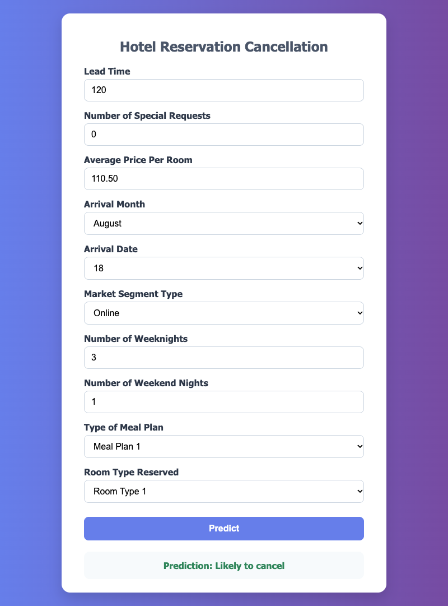
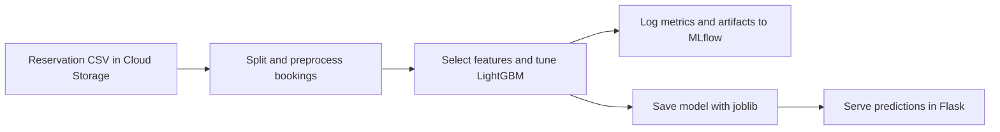

# Hotel Reservation Cancellation Prediction

A LightGBM classifier predicts whether a hotel booking will be canceled from details such as lead time, room price, and market segment. The project packages training, MLflow experiment tracking, and a Flask prediction form in a single repository.



## Run the demo

From the repository root, use [uv](https://docs.astral.sh/uv/) with Python 3.10. LightGBM needs OpenMP at runtime. Install `libomp` on macOS with `brew install libomp`, or `libgomp1` on Debian and Ubuntu if it is missing.

```sh
uv sync --frozen --python 3.10
uv run --frozen --python 3.10 flask --app app run --host 127.0.0.1 --port 8080
```

Open [the local form](http://127.0.0.1:8080/). It loads the [saved model](artifacts/models/lgbm_model.pkl), so the demo can run without retraining or cloud credentials.

Try a booking made 120 days in advance with no special requests, an average room price of €110.50, and arrival on August 18. Select **Online**, enter **3 weeknights** and **1 weekend night**, then choose **Meal Plan 1** and **Room Type 1**. The saved model predicts **Likely to cancel**.

## Training and deployment



The [training pipeline](pipeline/training_pipeline.py) splits the bookings 80/20 from the source CSV. It encodes categories, balances classes with SMOTE, and selects ten features using random forest importances. LightGBM uses randomized cross-validation to tune the classifier. The [Dockerfile](Dockerfile) builds the serving image and runs training during the build. The [Jenkinsfile](Jenkinsfile) defines the image build, registry push, and Cloud Run deployment. The live deployment status is unverified.

## Saved model evaluation

I scored the checked-in model on the [original test split](artifacts/raw_data/test.csv) before oversampling. It contains **7,255 bookings**, including **2,446 cancellations**, and its booking IDs are disjoint from the training split. Categorical values use the encodings fitted on the training split. The baseline predicts that every booking will be kept.

| Model | Accuracy | Cancellation precision | Cancellation recall | Cancellation F1 |
| --- | ---: | ---: | ---: | ---: |
| LightGBM | 87.2% | 80.2% | 82.5% | 81.3% |
| Always predict no cancellation | 66.3% | — | 0.0% | 0.0% |

The baseline produces zero cancellation predictions, so its cancellation precision is undefined. The training pipeline’s saved metrics use a test set rebalanced with SMOTE. The table above uses the original cancellation rate from the raw test split.

## Sources

This is my implementation of the hotel project from Sudhanshu Gusain and KRISHAI Technologies’ MLOps course. The repo includes my dependency setup using uv, modeling notebook, Flask app, and Cloud Run deployment configuration. [Course](https://www.udemy.com/course/mastering-advanced-mlops-on-gcp-cicd-kubernetes-kubeflow/) · [Hotel Reservations dataset](https://www.kaggle.com/datasets/ahsan81/hotel-reservations-classification-dataset)
